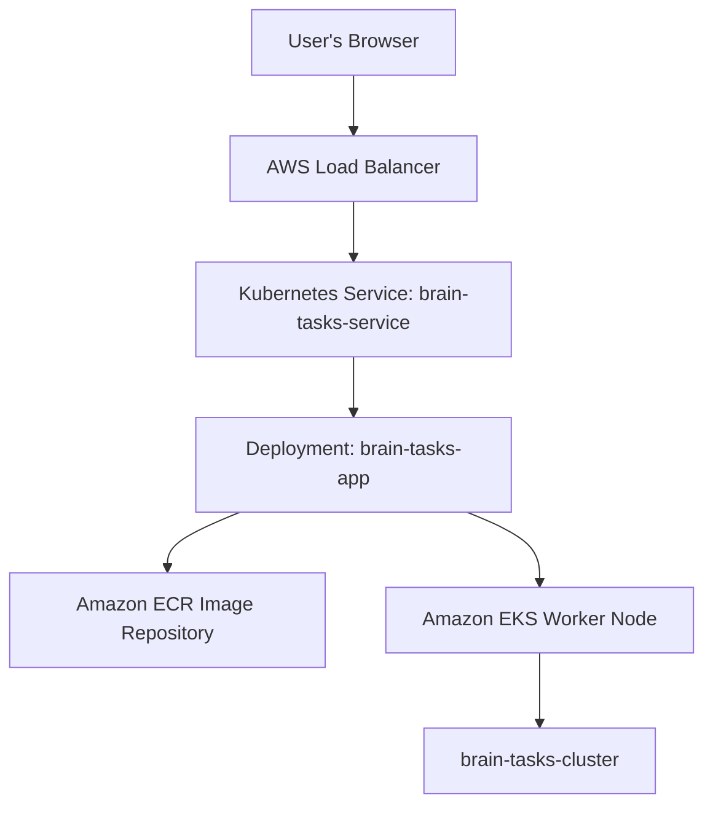

# Brain Tasks App — AWS EKS Deployment

A containerized Brain Tasks application deployed to Amazon Elastic Kubernetes Service (Amazon EKS), with an image stored in Amazon Elastic Container Registry (Amazon ECR) and a public AWS Load Balancer exposing the application.

## Project Overview

This project demonstrates a cloud-native deployment workflow:

1. Package the application into a Docker image.
2. Push the image to Amazon ECR.
3. Run the application on an Amazon EKS Kubernetes cluster.
4. Expose the application through a Kubernetes `LoadBalancer` Service.
5. Verify the running application using the load balancer's DNS name.

## Architecture



## Deployment Details

| Resource | Value |
|---|---|
| AWS Region | `ap-southeast-2` |
| EKS Cluster | `brain-tasks-cluster` |
| EKS Node Group | `brain-tasks-nodes` |
| Kubernetes Deployment | `brain-tasks-app` |
| Kubernetes Service | `brain-tasks-service` |
| ECR Repository | `brain-tasks-app` |
| Container Image | `853491227853.dkr.ecr.ap-southeast-2.amazonaws.com/brain-tasks-app:latest` |
| Service Type | `LoadBalancer` |
| Load Balancer DNS | `a423d723667e04e18a592adf6030d8ea-554931457.ap-southeast-2.elb.amazonaws.com` |

> **Note:** The public load balancer DNS is environment-specific and may change if the Service or load balancer is recreated. AWS resources can incur charges while running.

## Technology Stack

- Docker — application containerization
- Amazon ECR — container image registry
- Amazon EKS — managed Kubernetes control plane
- Kubernetes Deployment and Service — application orchestration and exposure
- AWS Load Balancer — public application access
- `kubectl` and AWS CLI — deployment and cluster management

## Prerequisites

Install and configure:

- AWS CLI
- `kubectl`
- Docker
- `eksctl` (if creating the cluster from the command line)
- An AWS identity with permissions to manage ECR, EKS, EC2, IAM, and load balancers

Check the tools:

```bash
aws --version
kubectl version --client
docker --version
eksctl version
```

Configure AWS credentials and the desired region:

```bash
aws configure
aws sts get-caller-identity
aws configure set region ap-southeast-2
```

Use least-privilege IAM permissions and avoid committing AWS credentials or access keys to source control.

## Build and Run Locally

Run these commands from the application directory. Adjust the Docker build context or port mapping to match the application's Dockerfile and configured port.

```bash
docker build -t brain-tasks-app:latest .
docker run --rm -p 8080:8080 brain-tasks-app:latest
```

Open `http://localhost:8080` if the app listens on port `8080`. If your application uses another port, update the port mapping accordingly.

## Push the Docker Image to Amazon ECR

Set the image variables:

```bash
AWS_REGION=ap-southeast-2
AWS_ACCOUNT_ID=853491227853
ECR_REPOSITORY=brain-tasks-app
IMAGE_URI=${AWS_ACCOUNT_ID}.dkr.ecr.${AWS_REGION}.amazonaws.com/${ECR_REPOSITORY}:latest
```

Create the ECR repository if it does not already exist:

```bash
aws ecr describe-repositories \
  --repository-names "${ECR_REPOSITORY}" \
  --region "${AWS_REGION}" \
|| aws ecr create-repository \
  --repository-name "${ECR_REPOSITORY}" \
  --region "${AWS_REGION}"
```

Authenticate Docker, build, tag, and push:

```bash
aws ecr get-login-password --region "${AWS_REGION}" \
  | docker login --username AWS --password-stdin \
    "${AWS_ACCOUNT_ID}.dkr.ecr.${AWS_REGION}.amazonaws.com"

docker build -t "${ECR_REPOSITORY}:latest" .
docker tag "${ECR_REPOSITORY}:latest" "${IMAGE_URI}"
docker push "${IMAGE_URI}"
```

Confirm that the image exists:

```bash
aws ecr describe-images \
  --repository-name "${ECR_REPOSITORY}" \
  --region "${AWS_REGION}"
```

## Connect `kubectl` to EKS

Update the local kubeconfig:

```bash
aws eks update-kubeconfig \
  --region ap-southeast-2 \
  --name brain-tasks-cluster
```

Verify the cluster and nodes:

```bash
kubectl config current-context
kubectl get nodes
kubectl get namespaces
```

The worker nodes should report `Ready`.

## Kubernetes Deployment

A Deployment manages the application Pods. Ensure the container port and health checks match the application.

Example `deployment.yaml` (replace `containerPort` with the port your app actually listens on):

```yaml
apiVersion: apps/v1
kind: Deployment
metadata:
  name: brain-tasks-app
spec:
  replicas: 1
  selector:
    matchLabels:
      app: brain-tasks-app
  template:
    metadata:
      labels:
        app: brain-tasks-app
    spec:
      containers:
        - name: brain-tasks-app
          image: 853491227853.dkr.ecr.ap-southeast-2.amazonaws.com/brain-tasks-app:latest
          imagePullPolicy: Always
          ports:
            - containerPort: 8080
```

Apply the Deployment and check its status:

```bash
kubectl apply -f deployment.yaml
kubectl rollout status deployment/brain-tasks-app
kubectl get deployments
kubectl get pods -o wide
```

## Kubernetes Service

A `LoadBalancer` Service asks AWS to provision a load balancer for external traffic.

Example `service.yaml` (ensure `targetPort` matches the container's listening port):

```yaml
apiVersion: v1
kind: Service
metadata:
  name: brain-tasks-service
spec:
  type: LoadBalancer
  selector:
    app: brain-tasks-app
  ports:
    - port: 80
      targetPort: 8080
      protocol: TCP
```

Apply and inspect it:

```bash
kubectl apply -f service.yaml
kubectl get services
kubectl describe service brain-tasks-service
```

Wait for the `EXTERNAL-IP` field to show the load balancer hostname. Then visit:

```text
http://a423d723667e04e18a592adf6030d8ea-554931457.ap-southeast-2.elb.amazonaws.com
```

If your app requires HTTPS, configure TLS and an appropriate ingress/load-balancer setup rather than assuming the HTTP endpoint is secure.

## Useful Kubernetes Commands

```bash
# Overview
kubectl get all
kubectl get nodes
kubectl get pods -o wide
kubectl get deployments
kubectl get services

# Application logs
kubectl logs deployment/brain-tasks-app
kubectl logs -l app=brain-tasks-app --tail=100

# Inspect resources and events
kubectl describe deployment brain-tasks-app
kubectl describe service brain-tasks-service
kubectl get events --sort-by=.metadata.creationTimestamp

# Restart and monitor a rollout
kubectl rollout restart deployment/brain-tasks-app
kubectl rollout status deployment/brain-tasks-app

# Roll back a Deployment when a previous revision exists
kubectl rollout undo deployment/brain-tasks-app
```

## Troubleshooting

### Pod is not starting

```bash
kubectl get pods
kubectl describe pod <pod-name>
kubectl logs <pod-name>
kubectl get events --sort-by=.metadata.creationTimestamp
```

Check the image URI, container port, application startup command, resource requests, and configuration.

### `ImagePullBackOff` or `ErrImagePull`

- Confirm the image exists in ECR and the URI is correct.
- Check that the EKS worker-node IAM role can pull from ECR.
- Verify the cluster and repository are in the expected AWS Region.
- Review Pod events with `kubectl describe pod <pod-name>`.

### Service has no external hostname

```bash
kubectl get service brain-tasks-service
kubectl describe service brain-tasks-service
kubectl get pods --show-labels
```

Check that the Service selector matches the Pod labels and that AWS load-balancer provisioning has completed. Also verify the required subnet tags, IAM permissions, and AWS Load Balancer Controller or cloud-provider configuration for your cluster setup.

### The hostname opens but the app does not load

- Confirm the application is listening on the configured container port.
- Confirm `targetPort` matches that port.
- Check Pod logs and Service endpoints:

```bash
kubectl get endpoints brain-tasks-service
kubectl logs deployment/brain-tasks-app
```

- Check security groups, network ACLs, and application-level errors.

## CI/CD Ideas

A CI/CD pipeline (for example, Jenkins, GitHub Actions, or AWS CodePipeline) can automate:

1. Checkout source code.
2. Run tests and quality checks.
3. Build the Docker image.
4. Authenticate to ECR using an approved AWS identity.
5. Push an image tagged with the commit SHA or release version.
6. Update the Kubernetes Deployment image.
7. Wait for rollout completion and run a smoke test.

For repeatable releases, prefer immutable image tags such as a Git commit SHA instead of relying only on `latest`. Store credentials in a secret manager or the CI platform's credential store; never hard-code them in a pipeline file.

## Security and Operations

- Do not commit AWS credentials, kubeconfig files, tokens, or secrets.
- Use least-privilege IAM roles and short-lived credentials where possible.
- Use resource requests and limits appropriate for the workload.
- Add readiness and liveness probes after confirming the correct health endpoint.
- Configure TLS for production traffic.
- Add monitoring, log retention, alerting, and backups where applicable.
- Restrict inbound access when public access is not required.
- Review AWS billing and remove unused resources.

## Cleanup

Delete the Kubernetes Service first to release its associated load balancer, then remove the application resources if they are no longer needed:

```bash
kubectl delete service brain-tasks-service
kubectl delete deployment brain-tasks-app
```

If the EKS cluster was created only for this project and you no longer need it, delete it using your approved process. For an `eksctl`-managed cluster, the command may be:

```bash
eksctl delete cluster --name brain-tasks-cluster --region ap-southeast-2
```

Before deleting anything, confirm the cluster is not shared and that you no longer need its workloads or data. Also review and remove unused ECR images/repositories if appropriate. Deleting resources is irreversible for some data, so verify first.

## License

Add the license that applies to your source code and dependencies. If this is a personal or learning project, state that explicitly.
